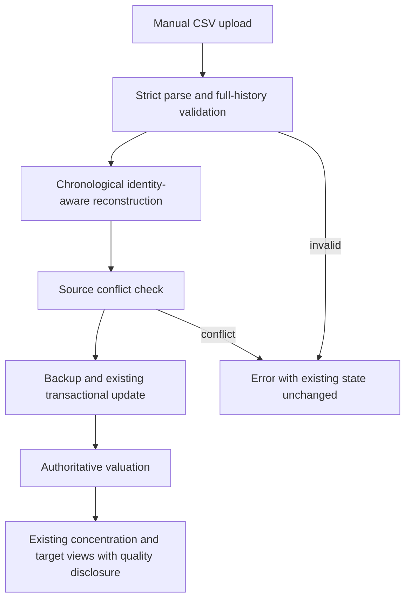

# CSV and Concentration Integrity - Plan

## Goal Capsule

- Objective: Nico can identify unintended concentration and drift from his targets without mistaking malformed imports or incomplete valuations for a complete portfolio.
- Means: Harden existing reconstruction and disclose existing analysis gaps (KTD1–KTD4).
- Authority: Approved task t_a3b1ab9f and repository safety rules govern product behavior; requirements govern implementation choices.
- Execution profile: Bounded personal finance maintenance, synthetic-only verification, autonomous implementation and independent review through an open PR.
- Stop: Essential missing input, protected operations, or evidence invalidating the approved workflow. Never read private databases, backups, exports or credentials.
- Delivery owner: Main Hermes verifies tests and exact-head CI; Nico reviews and merges. No deployment or merge authority.

---

## Product Contract

### Summary

Repair proven import integrity failures and make incomplete concentration/target analysis explicit in the existing interfaces. Preserve all current features, source semantics and manual inputs.

### Problem Frame

The current parser can accept incomplete numeric rows and replace historical dates with the present. Reconstruction groups incoming transactions before outgoing ones, which can misstate remaining invested basis. Source-scoped deletion does not currently guarantee source-scoped updates. Concentration percentages consume authoritative numeric values but do not disclose positive-share holdings with missing valuation.

### Key Decisions

- Keep manual Parqet imports (session-settled: user-directed — chosen over API/direct-broker automation: current workflow is sufficient). Governs R1, R2.
- Keep virtual portfolios and manual classifications (session-settled: user-directed — chosen over a new grouping model: existing assignments express the user's intent). Governs R3, R4.

### Requirements

**Import integrity**

- R1. Continue reconstructing supported Parqet full-history transaction CSVs; do not infer omitted history or new vendor-specific corporate actions.
- R2. Malformed full-history imports fail without changing existing holdings; valid repeated imports remain deterministic.
- R3. Imports preserve unrelated sources/manual assets, quantity and identifier overrides, assignments, classifications, targets and custom valuations.

**Analysis integrity**

- R4. Concentration uses company domicile/manual country override and existing user-defined sector/theme semantics, never revenue geography or ETF look-through.
- R5. Verify existing cash denominators, selected-portfolio aggregation and target deviations; missing values, classifications or targets remain explicitly unknown.
- R6. Failed or stale data must not be presented as a newly refreshed complete portfolio; preserve frozen monthly-review snapshot semantics.

**Compatibility and delivery**

- R7. Preserve simulations, exports, monthly review, manual assets and every current workflow; no feature removals.
- R8. Deliver synthetic regression coverage, independent review, browser QA where available and an open focused PR with exact limitations and CI evidence.

### Scope Boundaries

No API integration, OAuth, direct IBKR automation, accounting/tax engine, new dashboard, new taxonomy, fractional strategy assignments, live-data inspection, deployment, trading or external account writes.

Considered and not built: transaction-row deduplication, because identical fills can be legitimate and the supported CSV has no authoritative transaction identity. Reconsider only with a supported stable vendor transaction ID.

Considered and not built: reinterpreting deposit/withdrawal aliases, because existing tests deliberately define their semantics and no vendor evidence authorizes changing them.

Considered and not built: changing raw position target-weight normalization or repricing frozen monthly reviews; existing contracts explicitly use raw targets and frozen snapshots. Disclose gaps without redefining user targets.

---

## Planning Contract

### Inspected Baseline

Base is origin/main at 919f71b, separate from open branding PR #59. Existing untracked number-input plan is unrelated and must not be read as a work source, changed or committed.

- `app/utils/csv_processing/parser.py`: missing shares/prices become zero in `_convert_numeric`; `_parse_dates` assigns current time to invalid dates. Existing strict-row handling otherwise rejects malformed replacement rows.
- `app/utils/csv_processing/company_processor.py`: two-pass reconstruction processes all incoming then all outgoing transactions; matching loads every source within the account.
- `app/utils/portfolio_processing.py`: parsing precedes backup and transaction writes; replacement requires successful backup, then source-scoped removal.
- `app/utils/csv_processing/share_calculator.py` and `portfolio_handler.py`: overrides are reconciled by name/identifier and edit timestamp.
- `frontend/src/lib/concentrations-calc.ts`: percentages divide by selected holdings plus optional cash; effective country is consumed correctly.
- `app/utils/value_calculator.py`: custom value, native price/FX then legacy EUR price are authoritative; missing valuation returns zero.
- `app/services/monthly_review_service.py`: readiness already distinguishes missing valuation and stale prices; snapshots are intentionally frozen.
- `tests/conftest.py`: isolated schema-seeded database fixtures, no startup tasks or network.

Research is repository-grounded. No external vendor semantics or dependencies are needed. Read-only scouts provided leads; implementation must independently verify them. A single-pass behavior trace follows upload → parse → backup → matching → override reconciliation → source-scoped deletion → commit → price refresh/receipt; parse failures must not reach writes. Existing concentration shaping reads server values; monthly review has its own readiness gate.

### Key Technical Decisions

- KTD1. Validate required identity, finite numeric and date values before destructive processing; optional fees/taxes may retain documented zero defaults. Preserve supported date/locale variants, stable same-time ordering and explicit zero transfer prices. Governs R1, R2.
- KTD2. Process supported transactions chronologically, using normalized identifiers to unify historical names and the latest supplied display name. Reject impossible long-only histories rather than clamping away missing history. Remaining invested basis remains proportional, not tax-lot accounting. Governs R1–R3.
- KTD3. Reject cross-source identity conflicts before any writes instead of silently taking ownership or inventing duplicate rows under the unique account/name constraint. Apply consistently to transaction and snapshot imports; do not migrate sources implicitly. Governs R3.
- KTD4. Extend existing concentration and target displays only where evidence proves a gap: disclose unvalued holdings, unknown classifications, freshness and target coverage using existing data. Keep existing numeric values and target contracts authoritative. Governs R4–R7.
- KTD5. Use synthetic schema-seeded fixtures and safe test app contexts; do not run default smoke.py or normal startup against private instance data. No schema migration is planned. Governs R8.

### Assumptions

- The importer is long-only; short positions and omitted opening inventory cannot be reconstructed safely from these transactions.
- Same-time transactions keep file order rather than inventing intraday ordering.
- Existing single-valued thesis strings remain user labels; do not split them into overlapping allocations without a supported data model.
- Exact UI warning placement and test helper names are implementation details; they must not widen scope.

### High-Level Technical Design

### Risks and Dependencies

Import changes affect persisted holdings: characterize behavior before editing and run GitNexus upstream impact for modified symbols. The recovered privacy-safe source index covers baseline 919f71b; exact context/impact work, but FTS concept search is unavailable. Mirror the actual source diff into that snapshot before detect-changes; its synthetic commit is not the application baseline. `process_companies` has HIGH upstream risk through import orchestration/background processing. UI quality warnings must not invent missing values. Broader pricing/FX redesign is excluded.

### Current Handoff Status

Reviewed against source using a bounded independent combined CE document review (not six isolated persona contexts). Accepted stable timestamp ties, explicit partial/all-unvalued display states and target-coverage disclosure; date/finiteness findings restated U1's already-planned repairs. Require a complete source/identity conflict check before rename writes, without introducing a new change-set framework. Upload-resource infrastructure was not added: no demonstrated new exposure within this bounded maintenance task. Cross-model corroboration is not claimed. Local main contains eight unpushed later commits through 486468c; leave it untouched and keep this branch based on origin/main 919f71b. No application code changed during planning.

---

## Implementation Units

### U1. Strict supported CSV validation

Goal: prevent malformed replacement imports from becoming false holdings or deletions.
Requirements: R1, R2, R3. Dependencies: none.
Files: `app/utils/csv_processing/parser.py`, `tests/test_csv_parser.py`, `tests/test_csv_receipts.py`.
Approach: Apply KTD1 using existing parse-summary/error contracts. Ensure strict validation happens before backup/writes.
Execution note: Add failing characterization tests for accepted malformed rows first.
Test scenarios:
- Blank shares or price, infinity/NaN, empty holding name and invalid or absent dates cannot replace a valid portfolio.
- Supported German decimals, ISO dates, timezone timestamps and mixed supported dates retain exact quantities and chronology.
- Optional blank fees/taxes and explicit zero-price security transfers remain supported.
- Invalid add-mode rows are disclosed or rejected, never silently converted into valid holdings.
Verification: Parser and upload tests pass with explicit error receipts and unchanged synthetic DB state on rejection.

### U2. Chronological reconstruction and source protection

Goal: quantities and proportional basis reflect supported history without stealing another feed's holding.
Requirements: R1–R3, R7. Dependencies: U1.
Files: `app/utils/csv_processing/company_processor.py`, `app/utils/csv_processing/transaction_manager.py`, `app/utils/portfolio_processing.py`, `tests/test_csv_import_db.py`, `tests/test_share_calculator.py`, `tests/test_csv_receipts.py`.
Approach: Apply KTD2 and KTD3 in existing helpers; preserve override reconciliation and transactions. Validate the complete match set before applying any rename. Stable sort keeps file order on timestamp ties. Minimize changes to write orchestration.
Test scenarios:
- Buy 10 at 10, sell 5, buy 10 at 20 yields 15 shares and 250 remaining proportional basis, regardless of input date order.
- Transfers in/out, sold-out then reopened holdings, identifier-based rename and stable same-time ordering are deterministic.
- Sell/transfer-out before available inventory fails safely instead of silently clamping to an invented balance.
- Importing the same full history twice preserves quantities, overrides, classifications, targets and assignments.
- Parqet import matching manual/IBKR name or identifier fails without mutating either source; snapshot import obeys the same rule.
Verification: Synthetic parser-to-database tests prove rollback and preservation, plus existing override/source-removal tests pass.

### U3. Existing analysis correctness and completeness

Goal: concentration and target views disclose limitations without changing user intent.
Requirements: R4–R7. Dependencies: none.
Files: `frontend/src/lib/concentrations-calc.ts`, `frontend/src/hooks/use-concentrations.ts`, `frontend/src/app/(dashboard)/concentrations/page.tsx`, `frontend/src/lib/__tests__/concentrations-calc.test.ts`, relevant existing target/heatmap tests and components as traced.
Approach: Apply KTD4. Trace effective country, value source, cash and target coverage end-to-end before editing. Reuse monthly-review readiness where applicable, without changing frozen snapshot semantics. Put an accessible quality summary above existing charts: selected holding count, known value, unavailable valuations/classifications and supplied price freshness. Mark charts as partial when values are missing; all-unvalued means valuation unavailable, not a complete zero portfolio. Account-wide cash remains explicitly account-wide under a portfolio filter. Preserve existing target displays: unset/null targets are unavailable, explicit zero remains zero, partial target coverage is disclosed and raw totals are not normalized. Do not invent target fields the server does not supply; expose that limitation rather than inferring intent.
Test scenarios:
- Two virtual portfolios aggregate correctly; selecting one changes the denominator without losing cash-toggle semantics.
- Manual country overrides beat market metadata; unknown country/sector/theme remain labelled unknown.
- Valued holding 900, cash 100 and positive-share unvalued holding disclose incomplete valuation instead of an unqualified complete 90%/100% picture.
- Missing/zero user targets remain distinguishable; raw weights totaling 80% or 120% are not silently normalized.
- Failed refresh/import preserves prior state and does not claim success; stale price coverage is visibly stale where the existing data supports it.
Verification: Pure calculations, backend contract tests and synthetic browser checks agree on amounts, denominators and visible quality warnings.

### U4. Review, regression and delivery

Goal: verified maintenance ready for Nico to merge.
Requirements: R7, R8. Dependencies: U1–U3.
Files: existing appropriate README or PR description for import expectations and Parqet/IBKR overlap recommendations; regression files touched by prior units.
Approach: Independent code review, resolve valid findings, simplify only duplicated new logic, synthetic browser QA, scoped commit and PR. Keep branding PR separate.
Test scenarios:
- Full backend/frontend suite, typecheck, lint and production build complete against synthetic-only verification paths.
- Browser exercises upload failure/success and concentration/target warnings without live backend data.
- Independent reviewer examines identity/source conflicts, chronology, parser failure and analysis denominators.
Verification: Exact PR head and required CI checked by read-back; no merge/deployment.

---

## Verification Contract

- Repository definition of done: `./test.sh` (backend pytest and frontend vitest).
- Frontend: `npm run lint`, TypeScript no-emit check and `npm run build` from `frontend/`, as supported by its manifest.
- Use existing isolated tests, never `smoke.py` as shipped. Temporary databases live in managed scratch space.
- GitNexus impact must precede symbol edits; detect-changes must confirm only intended symbols before committing.
- Browser QA uses synthetic responses or an explicitly isolated synthetic app, not the normal live service.
- Independent review must actually run; self-inspection is not independent.

---

## Definition of Done

All R1–R8 verified, regression tests cover each fixed defect, independent findings corrected and rechecked, and no abandoned code or unrelated WIP remains in the diff. Open focused PR includes exact tests, compatibility/full-history limitations, documented keep/revisit overlap recommendations and relationship to branding PR #59. Required CI passes on the exact head, or absent CI is explicitly recorded. Nothing merged or deployed.
